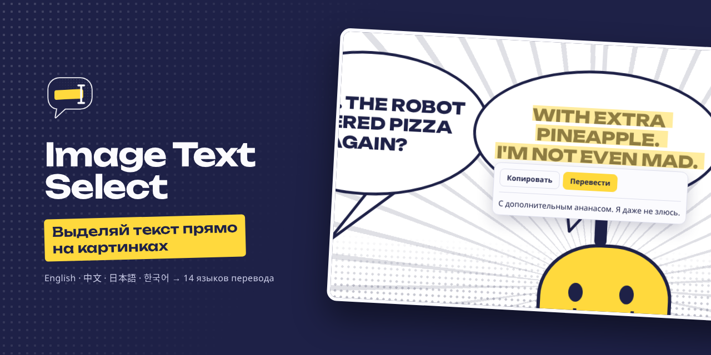
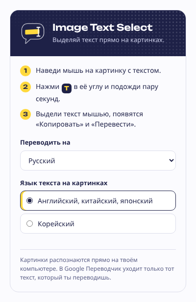
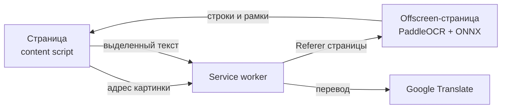

<p align="center">
  
</p>

<p align="center">
  <a href="LICENSE"></a>
  
  
</p>

<p align="center">
  Расширение для Chrome, которое делает текст на картинках выделяемым.<br>
  Наводишь мышь, жмёшь <b>T</b> и выделяешь текст как обычный: копируешь или переводишь.
</p>

<p align="center"><a href="#english">English below</a></p>

---

<table>
  <tr>
    <td width="50%" valign="top">
      <br>
      <b>Распознаёт на твоём компьютере</b><br>
      Модель PaddleOCR работает прямо в браузере. Картинки никуда не загружаются.
    </td>
    <td width="50%" valign="top">
      <br>
      <b>Английский, китайский, японский, корейский</b><br>
      Вертикальный текст тоже. Перевод на 14 языков.
    </td>
  </tr>
  <tr>
    <td width="50%" valign="top">
      <br>
      <b>Длинные ленты комиксов</b><br>
      Вертикальную ленту в десятки тысяч пикселей распознаёт кусками и не теряет строки на стыках.
    </td>
    <td width="50%" valign="top">
      <br>
      <b>Реплика переводится целиком</b><br>
      Строки облачка склеиваются в одну фразу, капс приводится к обычному регистру. Перевод получается связным.
    </td>
  </tr>
</table>

## Как пользоваться

1. Наведи мышь на картинку с текстом. В углу появится кнопка **T**.
2. Нажми её и подожди пару секунд, пока текст распознается.
3. Выдели текст мышью. Работают Ctrl+C и обычное меню правой кнопки, а рядом появятся «Копировать» и «Перевести».

Язык перевода и модель для корейского выбираются по клику на значок расширения.

<p align="center">
  
</p>

## Установка

Скоро в Chrome Web Store. Пока можно поставить из исходников:

```bash
git clone https://github.com/SLam2Y/img-text-select.git
cd img-text-select
npm install
npm run setup
```

`setup` кладёт ONNX Runtime и paddleocr.js в `vendor/` и скачивает модели распознавания (~35 МБ) в `models/`. Дальше открой `chrome://extensions`, включи «Режим разработчика», нажми «Загрузить распакованное» и выбери папку проекта.

## Как это устроено



- **Content script** рисует кнопку, прозрачный слой текста поверх картинки и окно перевода. Слой лежит в обычном DOM, поэтому выделение родное.
- **Offscreen-страница** скачивает картинку, режет длинные ленты на куски и запускает PaddleOCR PP-OCRv5 на WebAssembly.
- **Service worker** передаёт запросы и подставляет Referer страницы для CDN с защитой от хотлинка.

## Разработка

```bash
npm test                          # модульные тесты
npx playwright install chromium
npm run e2e                       # прогон в Chromium без окна с загруженным расширением
npm run pack                      # dist.zip для Chrome Web Store
```

Скриншоты для магазина: `node store/make-shots.mjs`. Картинки для README: `node docs/readme/make.mjs`. Тексты для формы магазина и обоснования разрешений: [store/listing.md](store/listing.md).

## Приватность

Картинки обрабатываются на твоём компьютере. В Google Translate уходит только текст, который ты сам отправил на перевод. Подробно: [PRIVACY.md](PRIVACY.md).

## Лицензия

[MIT](LICENSE). Сторонние компоненты (PaddleOCR, ONNX Runtime, paddleocr.js, шрифт Unbounded) и их лицензии: [CREDITS.md](CREDITS.md), [licenses/](licenses/).

---

<a id="english"></a>

## English

**Image Text Select** is a Chrome extension that makes text inside images selectable. Hover an image, press **T**, and select the text like any other text on the page, then copy or translate it.

- OCR runs on your device (PaddleOCR PP-OCRv5 on ONNX Runtime Web). Images are never uploaded.
- English, Chinese, Japanese and Korean, including vertical text and long vertical comic strips.
- Native selection: Ctrl+C and the right-click menu work. Multi-line speech bubbles are translated as one sentence.
- Translation via Google Translate, with Chrome's on-device Translator API as a fallback.

Install from source: `npm install && npm run setup`, then load the folder as an unpacked extension in `chrome://extensions`. Privacy: [PRIVACY.md](PRIVACY.md). License: [MIT](LICENSE).
